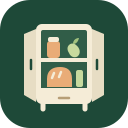
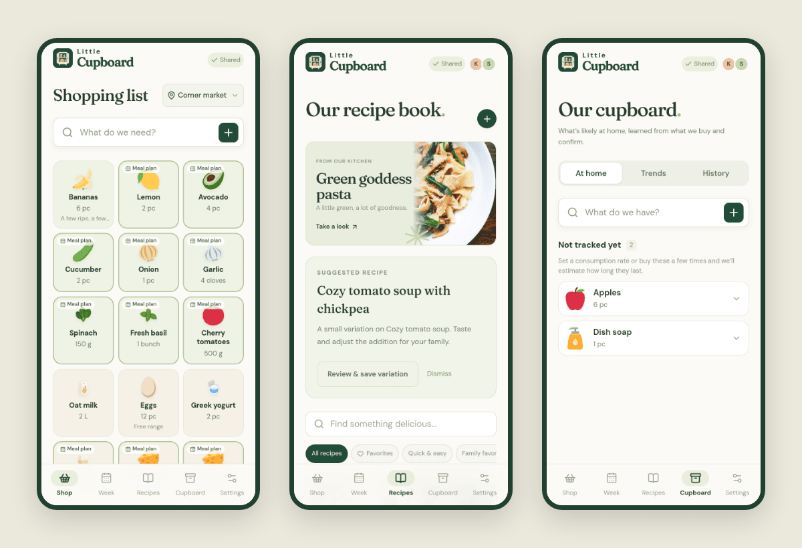
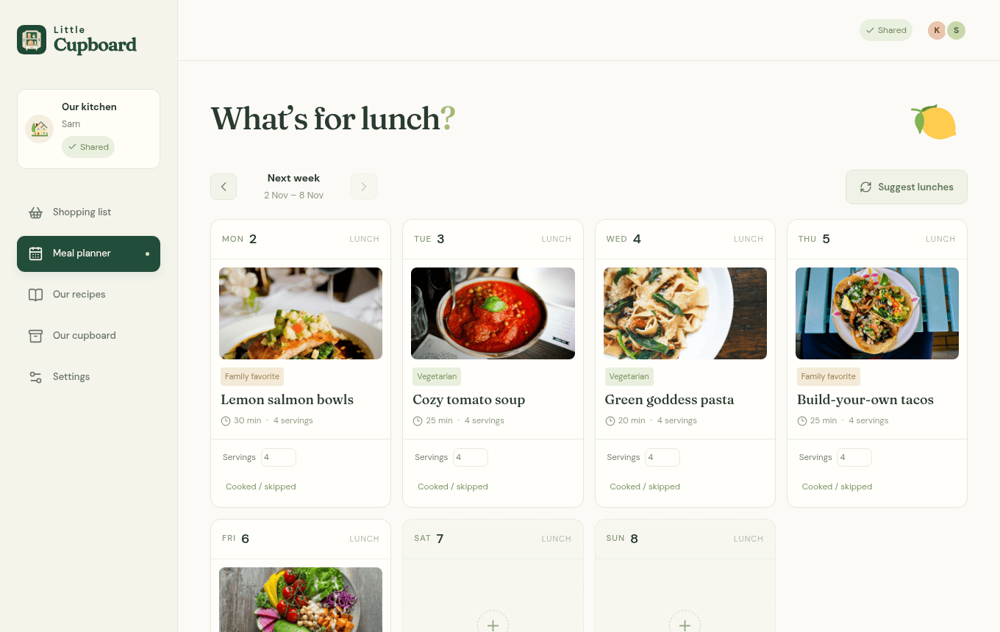

<p align="center">
  
</p>

<h1 align="center">LittleCupboard</h1>

A shopping list, recipe book and lunch planner for one household, meant to be self-hosted and shared between everyone's phones. I wanted something that's quick to use one-handed in a shop and that remembers what we cook, so the list mostly writes itself.

<p align="center">
  
</p>



_Screenshots use a throwaway household with sample recipes._

## What it does

The shopping list is a grid of big tiles. Tap a tile when it's in the basket, hold it (or right-click on desktop) to change the amount or add a note. Checked items move below the list until the trip is over, in case you tapped the wrong one. Pick the shop you're in and the list follows that shop's aisle order.

Plan lunches for the week from your recipes, and whatever the plan needs that isn't already at home shows up on the list with a small "Meal plan" marker. Recipes have photos, tags, favourites and serving scaling.

The Cupboard tab keeps a rough idea of what's at home. You can set how fast you go through something (say 4 L of milk a week) or let it learn from what you buy, and it suggests when to restock. Estimates are always labelled as estimates and never overwrite amounts you've entered yourself.

Everyone in the household has their own account. Changes show up on other devices right away, and the app works offline as an installed PWA: anything you check or add without a connection is queued and synced later. If two people edit the same item at once you get asked which version to keep.

An AI assistant is optional and off by default. With an OpenAI-compatible endpoint configured it can add things to the list from a sentence or a photo, draft recipes, suggest a week of lunches and generate item icons. API keys are encrypted on the server and never sent to the browser.

## Running it locally

You need Nix with flakes. The dev shell provides Node, Rust and Chromium.

```sh
nix develop
npm ci
npm run dev
# in a second `nix develop` shell
cargo run --manifest-path backend/Cargo.toml
```

Open http://localhost:3100 (Vite proxies `/api` to the backend on port 3001). On first start the server writes a setup token to `data/setup-token`; paste it into the setup screen to create the first account. You can start with five sample recipes or an empty book. Everything the server stores ends up in `data/`, which is ignored by Git.

## Configuration

The server is configured with environment variables:

- `LITTLECUPBOARD_ORIGIN`: the exact URL people open, e.g. `https://cupboard.example.com`. Used for cookies and same-origin checks.
- `LITTLECUPBOARD_DATA_DIR`: where the SQLite database and uploaded photos live (`/data` in the container).
- `LITTLECUPBOARD_SETUP_TOKEN` and `LITTLECUPBOARD_SECRET_KEY`: the one-time setup token and the 64-character hex key that encrypts AI credentials. Both are generated into the data directory if unset. Keep the key; losing it makes saved AI settings unreadable.
- `LITTLECUPBOARD_SQLITE_JOURNAL_MODE=DELETE` if the data directory is on NFS. The default WAL mode needs local or block storage.
- `LITTLECUPBOARD_OIDC_*` for optional passkey sign-in through an OpenID Connect provider such as Pocket ID.

The AI provider is set up in the app under Settings, not through environment variables.

## Deploying

CI publishes `ghcr.io/fruitiex/littlecupboard:main`. The image runs the API and the built frontend in one non-root process on port 8080. Put it behind your own HTTPS reverse proxy, mount persistent storage at `/data`, run a single replica, and set `LITTLECUPBOARD_ORIGIN` to the public URL.

```sh
docker run --rm -p 127.0.0.1:8080:8080 \
  -e LITTLECUPBOARD_ORIGIN=http://localhost:8080 \
  -v littlecupboard-data:/data ghcr.io/fruitiex/littlecupboard:main
```

You can also build the image yourself with `nix build .#container && docker load < result`. Example Kubernetes manifests are in [deploy/kubernetes](deploy/kubernetes). [docs/DEPLOYMENT.md](docs/DEPLOYMENT.md) covers reverse proxy settings, OIDC, backups, upgrades and the AI options in more detail, and [docs/HERMES-COMPANION.md](docs/HERMES-COMPANION.md) describes the optional personal AI worker.

## Development

The frontend is TanStack Start/Router with React, TypeScript and Tailwind. The backend is Rust (Axum, Tokio, SQLite), and the shared API types are generated from Rust with ts-rs. CI runs roughly this:

```sh
nix develop --command npm run typecheck
nix develop --command npm test
nix develop --command npm run format:check
nix develop --command cargo fmt --manifest-path backend/Cargo.toml -- --check
nix develop --command cargo clippy --manifest-path backend/Cargo.toml -- -D warnings
nix develop --command cargo test --manifest-path backend/Cargo.toml
nix develop --command npm run build
nix develop --command npm run test:production
```

`test:production` drives the production build in headless Chromium with two signed-in users and temporary databases: shared shopping, offline use, recipe and pantry editing, and AI flows against a fake provider. `npm run test:oidc` and `npm run test:container` cover passkey sign-in and the built image.

[docs/PLAN.md](docs/PLAN.md) has the original requirements and design decisions.

## Credits

Food and household illustrations are [Twemoji](https://github.com/twitter/twemoji) by Twitter and contributors, licensed [CC BY 4.0](https://creativecommons.org/licenses/by/4.0/) (license in `public/images/food/LICENSE-GRAPHICS.txt`). `backend/assets/item-style-reference.png` arranges six of them as a style reference for icon generation and is rebuilt by `scripts/render-item-reference.mjs`.

DM Sans and Fraunces come from [Google Fonts](https://github.com/google/fonts) under the SIL Open Font License (see `public/fonts/`).

The sample recipe photos are from Unsplash under the [Unsplash License](https://unsplash.com/license): [pasta](https://images.unsplash.com/photo-1473093226795-af9932fe5856), [salmon](https://images.unsplash.com/photo-1467003909585-2f8a72700288), [salad](https://images.unsplash.com/photo-1512621776951-a57141f2eefd), [tomato soup](https://unsplash.com/photos/tomato-soup-6eCpa9J3c_c) and [tacos](https://images.unsplash.com/photo-1551504734-5ee1c4a1479b).

The app icon is `public/icon.svg`; `npm run icons` exports the PWA PNGs from it.
