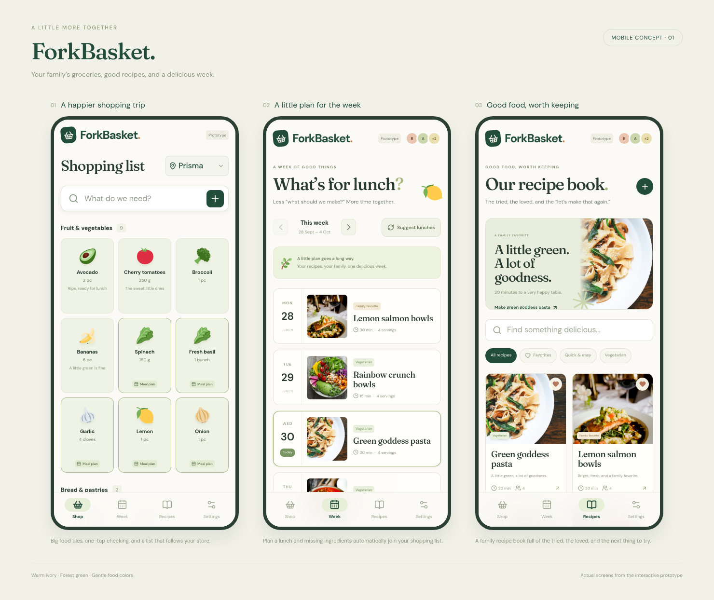

# ForkBasket

A family shopping list, recipe book, and weekly lunch planner. This repository starts with a working mobile-first prototype and a Rust service scaffold.



## Run the prototype

On NixOS or another machine with Nix flakes enabled:

```sh
cd /home/rasse/forkbasket
nix develop
command -v node npm cargo cc
npm ci
npm run dev
```

Open **http://localhost:3100**. The dev server also listens on your network interfaces, so you can open the machine’s address at port 3100 on a phone when your network and firewall allow it. Changes are stored per browser; opening the prototype on two devices does not share their shopping lists yet.

In a second terminal, start the API scaffold:

```sh
nix develop --command cargo run --manifest-path backend/Cargo.toml
```

The frontend proxies `/api` to `127.0.0.1:3001`. `GET /api/health` returns the typed service health response. The API currently provides this endpoint only.

## Explore the screens

- `/`: grouped food tiles, tap to check/restore, hold to edit, autocomplete across 178 built-in products, custom items, searchable shop selection, store sorting, automatic meal ingredients, and expandable restock suggestions. Right-click or Shift+F10 also opens editing.
- `/week`: current/next week, lunch selection and replacement, suggestions from saved recipes, and automatic missing ingredients in the shopping list.
- `/recipes`: recipe search, favorites and filters, ingredient selection and serving scaling, instructions, recipe entry, and optional small image uploads.
- `/settings`: favorite stores, individual aisle ordering, prototype reset, and the planned location of optional provider configuration.

The prototype saves changes locally and updates other tabs in the same browser. It uses illustrative recipes, sample history, and demo family avatars. Server persistence, invitations, cross-device realtime sync, learned inventory/purchase patterns, and AI are planned next; the assistant is absent from ordinary navigation until an actual provider integration is available.

Meals from today through the end of next week automatically contribute ingredients. Existing quantities on the list cover those requirements; extra amounts get a “Meal plan” marker. Checking remembers the covered meal requirements, restoring reverses the last check, and removing an ingredient skips its current requirements. Changing a meal updates automatic groceries while keeping manual additions. This is best-effort coverage, without an exact pantry count.

The full product scope, pattern-learning design, architecture, and remaining phases are recorded in [docs/PLAN.md](docs/PLAN.md). Project instructions in [AGENTS.md](AGENTS.md) require future work to read and maintain that plan.

## Mockups

Actual browser captures are saved in [mockups/](mockups/): a three-screen mobile overview, individual mobile views and full-page captures, a recipe detail dialog, store settings, and a desktop shopping screen. Open [mockups/overview.html](mockups/overview.html) locally for the presentation board.

With the frontend running, regenerate the screenshots using the Chromium included in the Linux Nix shell:

```sh
nix develop --command npm run mockups
```

Set `FORKBASKET_URL` to use another server URL. On macOS, the dev shell supplies Node and Rust but not Chromium; install a supported Playwright Chromium or set `PLAYWRIGHT_CHROMIUM_EXECUTABLE` to an existing browser executable.

## Validate changes

```sh
nix develop --command npm run build
nix develop --command npm run typecheck
nix develop --command npm run format:check
nix develop --command npm test
nix develop --command cargo fmt --manifest-path backend/Cargo.toml --check
nix develop --command cargo clippy --manifest-path backend/Cargo.toml -- -D warnings
nix develop --command cargo test --manifest-path backend/Cargo.toml
# Requires the frontend dev server:
nix develop --command npm run test:ui
```

Unit tests cover ingredient merging, compatible/incompatible units, automatic meal requirements and quantity top-ups, purchase/restore coverage, skipped ingredients, plan changes, old-data migration, restock eligibility, and calendar boundaries. Browser checks exercise shopping actions, touch holds and keyboard edits, product and shop autocomplete (including a long shop list), local persistence and tab updates, store sorting, recipe quantity merging, automatic planning, recipe entry, and all four screens at 320, 390, 768, and 1440 pixels. Rust tests also export the ts-rs health type into `src/lib/api/`.

## Stack

TanStack Start and Router, React, TypeScript, Tailwind CSS, Radix Dialog, Motion, and Lucide on the frontend. Tokio, Axum, Serde, and ts-rs on the backend. `flake.lock`, `package-lock.json`, and `backend/Cargo.lock` pin the development environment and dependencies.

## Asset credits

Food and household SVG illustrations are [Twemoji](https://github.com/twitter/twemoji), copyright Twitter and contributors, licensed under [CC BY 4.0](https://creativecommons.org/licenses/by/4.0/). The bundled license is in `public/images/food/LICENSE-GRAPHICS.txt`. They replace platform-dependent emoji rendering; the graphics themselves are unmodified.

DM Sans and Fraunces are bundled from [Google Fonts](https://github.com/google/fonts), with their SIL Open Font License files in `public/fonts/`.

Illustrative recipe photography is downloaded from Unsplash and bundled locally under the [Unsplash License](https://unsplash.com/license): [pasta](https://images.unsplash.com/photo-1473093226795-af9932fe5856), [salmon](https://images.unsplash.com/photo-1467003909585-2f8a72700288), [salad](https://images.unsplash.com/photo-1512621776951-a57141f2eefd), [tomato soup](https://unsplash.com/photos/tomato-soup-6eCpa9J3c_c), and [tacos](https://images.unsplash.com/photo-1551504734-5ee1c4a1479b). These photos illustrate the sample recipes rather than documenting their exact preparation.
